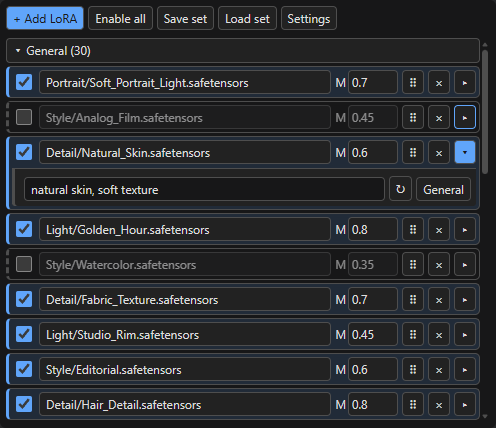
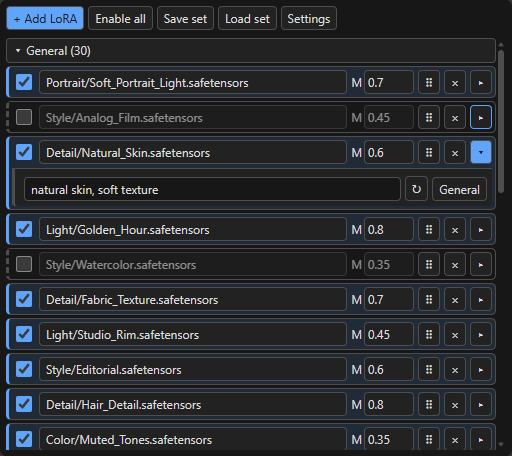

<div align="center">

# ND Super Nodes · Afrody Edition

### More LoRAs. Less clutter. A clearer workflow.
### 多个 LoRA，一目了然。让工作流更清爽。

A compact, resizable Super LoRA Loader for **Nodes 2.0 and classic ComfyUI**.

为 **Nodes 2.0 与经典模式**改进的 Super LoRA Loader：紧凑、可伸缩、状态清晰。

[English](#english) · [中文说明](#中文说明) · [Download / 下载](https://github.com/Afrody9387/nd-super-nodes/releases) · [Original project / 原项目](https://github.com/HenkDz/nd-super-nodes)



**One line per LoRA · Drag to reorder · Expand only what you need**

**一行一个 LoRA · 按住拖动排序 · 需要时再展开详情**

</div>

## English

Keep your LoRA stack readable, even when it grows. Adjust strengths beside the file name, spot enabled rows immediately, and open trigger words only when you need them. Drag the node taller to see more; keep it small when canvas space matters.

This is an independently maintained fork of **[HenkDz/nd-super-nodes](https://github.com/HenkDz/nd-super-nodes)**, building on the original loader, selector and template tools with frontend compatibility fixes and a redesigned LoRA list.

### What feels better

| Improvement | What you get |
| --- | --- |
| **One compact row** | Switch, LoRA name and strength together. One Model field by default; optional separate Model / CLIP strengths. |
| **Details on demand** | The rightmost triangle opens trigger words and the tag button. Details start collapsed, so unused fields take no extra space. |
| **A list that fits your node** | Both modes scroll inside the node. Resize taller or shorter to choose how many rows you see; edits preserve your chosen height. |
| **Grab, drag, done** | A single grip replaces up/down arrows. An insertion marker shows the drop position; dragging near the list edge scrolls automatically. |
| **Arrange whole categories** | Drag the grip on a category header to move the entire group, even when collapsed. Internal LoRA order and collapse state stay intact; workflow saves retain your category order. |
| **Clear on/off states** | Enabled rows have a theme accent and solid side stripe. Disabled rows use a neutral surface, dashed stripe and dimmed names/strengths. |
| **Readable expanded details** | A separate surface, divider and indentation distinguish trigger/tag details. The open triangle is highlighted. Colors follow the active theme. |
| **Modern and classic support** | Native DOM controls work in Nodes 2.0 and classic Canvas. This fork also fixes missing LoRA execution parameters and workflow persistence on affected frontend versions. |

**The original conveniences stay:** multi-select LoRA picking, per-LoRA switches, automatic/manual trigger words, saved sets, duplicate detection and collapsible tag groups. **General is a grouping tag**; its button lives in the expandable details alongside trigger words.

### Same compact controls in both modes

| Nodes 2.0 | Classic Canvas |
| :---: | :---: |
|  |  |

*Actual UI captures with illustrative file names and trigger words. The example contains 30 rows; the scrollbar keeps them inside the node. These are interface examples, not image-generation results.*

### Install the latest fork

For all improvements shown here, use the current `main` branch. From `ComfyUI/custom_nodes`:

```bash
git clone https://github.com/Afrody9387/nd-super-nodes.git nd-super-nodes
```

Already using a Git installation of this fork? Open its folder and run:

```bash
git pull --ff-only
```

Restart ComfyUI, then hard-refresh the browser (`Ctrl+F5` on Windows). Search for **Super LoRA Loader**, connect MODEL and optionally CLIP, and click **+ Add LoRA**.

Prefer a ZIP? Download a compiled package from [Releases](https://github.com/Afrody9387/nd-super-nodes/releases), create `ComfyUI/custom_nodes/nd-super-nodes`, and extract the package there with `__init__.py` directly inside that folder. Packages may trail `main`; check the release notes for included improvements. Back up an existing installation before replacing it, and keep only one installed copy.

### More than the loader

**ND Super Selector** adds a searchable file picker with folder navigation and multi-select to supported loader nodes. Right-click a supported node and select **⚡ Enable ND Super Selector**. Saved LoRA sets let you reuse combinations without rebuilding the list.

<details>
<summary>See the selector and saved-set browser</summary>


These two captures show the existing selector/template tools; the screenshots above show the redesigned LoRA list.

</details>

## 中文说明

LoRA 加得多，节点也能保持清楚好用。权重就在名字旁边，启用状态一眼可见，触发词按需展开；把节点拉高就能看到更多条目，缩小也能继续在列表里滚动。

这是基于 **[HenkDz/nd-super-nodes](https://github.com/HenkDz/nd-super-nodes)** 独立维护的分支。在保留原有加载器、文件选择器和模板功能的基础上，修复前端兼容问题，并重新整理 LoRA 列表的交互与布局。

### 这版改善了什么

| 改善点 | 用起来有什么不同 |
| --- | --- |
| **一行一个 LoRA** | 开关、名字、权重放在同一行。默认一个 Model 权重框，也可在设置中开启独立 Model / CLIP 权重。 |
| **触发词按需展开** | 点击最右侧三角，才显示触发词和分组按钮；默认收起，减少纵向占位。 |
| **滚动列表＋自由调整高度** | 经典模式和 Nodes 2.0 都能在节点内部滚动。节点拉高显示更多，缩短也不撑开；修改权重、添加 LoRA 不会重置设定的高度。 |
| **直接拖动排序** | 一个拖动手柄代替上下箭头。插入标记提示放置位置，拖到列表边缘自动滚动。 |
| **分类也能拖动排序** | 按住分类标题右侧手柄，移动整个分类，收起时也能拖动。分类内 LoRA 顺序、折叠状态保持，分类顺序随工作流保存。 |
| **启用、停用一眼分清** | 启用项使用主题色底和左侧实线；停用项使用中性底色、虚线，名字与权重适度变淡。 |
| **详情有清楚的层次** | 展开区域使用独立底色、分隔线和缩进，三角同步高亮；配色跟随当前主题。 |
| **兼顾新旧节点设计** | Nodes 2.0 与经典 Canvas 均使用原生 DOM 控件；同时修复受影响前端版本中 LoRA 执行参数缺失、工作流保存恢复的问题。 |

**保留原有实用功能：** 批量选择 LoRA、逐项启用、自动/手动触发词、保存与加载组合、防重复添加、按标签折叠分组。**General 是分组标签**，按钮已收进三角展开的详情区。

上方两张截图分别展示 Nodes 2.0 和经典模式。截图来自实际界面，使用演示文件名和触发词；列表中有 30 项，通过内部滚动条浏览，不代表生图效果。

### 安装与更新

想用到页面展示的全部改善，建议安装当前 `main` 分支。在 `ComfyUI/custom_nodes` 文件夹中执行：

```bash
git clone https://github.com/Afrody9387/nd-super-nodes.git nd-super-nodes
```

已经安装本分支的 Git 版本，在插件文件夹中更新：

```bash
git pull --ff-only
```

重启 ComfyUI，再按 **Ctrl+F5** 强制刷新。搜索 **Super LoRA Loader** 添加节点，接入 MODEL（CLIP 可选），点击 **+ Add LoRA** 开始添加。

也可到 [Releases 下载编译好的 ZIP](https://github.com/Afrody9387/nd-super-nodes/releases)。新建 `ComfyUI/custom_nodes/nd-super-nodes` 文件夹，把包内文件解压到这里，确保 `__init__.py` 直接位于该文件夹内。发布包可能稍晚于 `main`，具体改善请看对应发布说明。已有安装请先备份，并只保留一份插件。

### 原有工具也继续保留

**ND Super Selector** 为支持的加载节点提供文件夹导航、搜索和多选。右键支持的节点，选择 **⚡ Enable ND Super Selector** 即可开启。常用 LoRA 组合还可以保存为模板，下次直接加载。

## Validation & development / 验证与开发

The redesigned list was checked in headless Edge against the actual **ComfyUI frontend 1.55.18**, using isolated backend fixtures. Checks cover both renderers, compact rows, expand/collapse, strengths, toggles, tags, drag sorting with edge scrolling, a 30-row bounded list, node resizing, wheel scrolling without canvas zoom, workflow reload and execution serialization. TypeScript checking and the Vite build pass. These checks do not submit GPU generation or establish compatibility with every ComfyUI version.

新版列表已使用实际 **ComfyUI 前端 1.55.18** 在 Edge 中验证，后端使用隔离的演示数据。覆盖新旧模式、紧凑布局、详情展开、权重与开关、分组、拖动排序及边缘滚动、30 项列表、节点拉伸、滚轮、工作流恢复和执行参数保存。类型检查与构建通过；验证不包含 GPU 生图，也不代表所有 ComfyUI 版本均已测试。

<details>
<summary>Build and run the checks / 构建与验证命令</summary>

```bash
cd frontend
npm ci
npm run type-check
npm run build
cd ..
python scripts/package_release.py
```

Serialization regression (use a checkout with upstream commit `83dba34` available for the before/after comparison):

```bash
node tests/verify_frontend_serialization.cjs --frontend-assets /path/to/comfyui_frontend_package/static/assets
```

Browser integration (install Playwright separately; set `PLAYWRIGHT_MODULE` if it is outside Node's module search path):

```bash
node tests/verify_nodes20_browser.cjs --frontend-root /path/to/comfyui_frontend_package/static --browser /path/to/chrome --screenshots /tmp/nd-super-qa
```

The fork workflow builds a compiled ZIP when `pyproject.toml` changes on `main`; Actions must be enabled. This fork does not publish to the upstream Comfy Registry project.

</details>

[Release notes / 发布说明](FORK_RELEASE_NOTES.md) · [Detailed documentation / 详细文档](docs/development.md) · [MIT License](LICENSE)

---

**Credits / 致谢:** Original project by **HenkDz and contributors**. Fork maintenance and interface improvements by **Afrody9387**. The original MIT license and attribution are retained. 本分支保留原作者 MIT 许可与署名，感谢原项目及贡献者。
